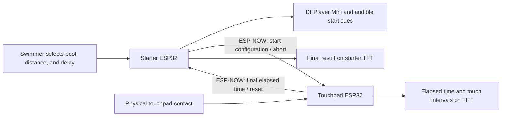

# Tactus

**An ESP32-based swimming timing system with a wireless starter, a physical finish touchpad, and dedicated touchpad test firmware.**

Tactus is an embedded hardware and firmware project designed to make timed swim practice possible without a second person operating a stopwatch. A swimmer configures an effort at the starter, receives an audible start sequence, and records wall contacts through a touchpad. The touchpad calculates elapsed time and successive touch intervals, then sends the final result back to the starter.

## The problem

Manual stopwatch timing requires someone to coordinate the start signal, recognize the finish, and operate the timer. For an individual training session, that creates a dependency on another person and adds human input at both ends of the measurement.

Tactus moves those tasks into a dedicated two-device workflow: a configurable start sequence, electronic touch detection, and results displayed at the poolside hardware. Its development also includes a separate test mode for evaluating the touchpad repeatedly without navigating the swim setup menus.

## System architecture



The two devices communicate directly using ESP-NOW. The implemented workflow does not require a Wi-Fi access point, a phone, or a cloud service. A third firmware project, **TEST MODE**, runs on the same touchpad hardware independently of the starter.

| Firmware | Hardware target | Responsibility |
| --- | --- | --- |
| [Starter](Starter/src/starter_main.cpp) | Starter ESP32 | Session configuration, countdown, audio commands, wireless control, final result display |
| [Finish Touchpad](Finish%20Touchpad/src/touchpad_main.cpp) | Touchpad ESP32 | Start reception, contact validation, elapsed time and touch intervals, finish reporting |
| [TEST MODE](TEST%20MODE/src/test_mode_main.cpp) | Touchpad ESP32 | Standalone repeated-contact testing with a visible counter capped at 400 |

## Implemented capabilities

- **Configurable practice efforts:** 25 yd, 25 m, or 50 m pool selection; distance choices appropriate to each pool setting.
- **Delayed start:** selectable 10, 15, 20, or 30 second countdown, followed by a take-your-marks cue and randomized 1–3 second interval before the start command and beep command.
- **Electronic contact detection:** active-low touchpad input with a 150 ms continuous-contact validation period.
- **Local timing and feedback:** elapsed time and successive touch intervals on the touchpad, final time returned to the starter, and device status LEDs.
- **Session controls:** starter-initiated abort and touchpad reset after a completed effort.
- **Dedicated touchpad testing:** button-initiated test, one count per qualified press and release, immediate visual feedback, and an automatic stop at 400 detections.
- **Shared display language:** ILI9341 TFT displays with a black background, cyan accents, and partial redraws for frequently changing values.

## Normal operating sequence

1. Power the starter and the touchpad running their normal firmware.
2. Select the pool length, swim distance, and start delay on the starter, then start the sequence.
3. The starter runs the countdown, commands the audio cues, and sends the start configuration to the touchpad.
4. The touchpad begins its local timer when it receives the start message and records qualified wall contacts.
5. When the configured number of contacts is reached, the touchpad holds the result and sends the final elapsed time to the starter.
6. Press the touchpad's external reset button to return both devices to their ready/setup states.

For sensor development, flash **TEST MODE** onto the touchpad instead. Press its external reset button to start at zero, press and release the pad repeatedly, and read the counter. At 400 detections the result remains visible until a fresh button press starts another run. See the [test-mode guide](TEST%20MODE/README.md).

## Repository layout

```text
Tactus/
├── README.md
├── Tactus.code-workspace
├── Starter/                 # Independently buildable starter firmware
│   ├── platformio.ini
│   └── src/starter_main.cpp
├── Finish Touchpad/         # Independently buildable normal touchpad firmware
│   ├── platformio.ini
│   └── src/touchpad_main.cpp
├── TEST MODE/               # Alternative firmware for the touchpad board
│   ├── platformio.ini
│   ├── src/test_mode_main.cpp
│   ├── include/test_mode_state.h
│   └── test/test_counter.cpp
└── docs/
    ├── architecture.md
    ├── hardware.md
    ├── flashing.md
    └── validation.md
```

Each firmware directory is a separate PlatformIO project. Keeping all three in one repository gives the system a single version history while preserving independent builds and uploads. Generated `.pio` directories and local editor configuration are excluded from version control.

## Build and flash

Open `Tactus.code-workspace` in VS Code with the PlatformIO extension installed. Choose the intended project before selecting **Build** or **Upload**.

From a PlatformIO terminal at the repository root:

```sh
pio run --project-dir "Starter"
pio run --project-dir "Finish Touchpad"
pio run --project-dir "TEST MODE"
```

All projects target `esp32dev` using the Arduino framework. The verified platform is Espressif32 6.13.0. Before using different ESP32 boards, configure the peer MAC addresses in the normal firmware and verify the wiring against the [hardware map](docs/hardware.md). The starter also requires DFPlayer audio media, which is not included in this repository.

See [build and flashing instructions](docs/flashing.md) for uploads and switching the touchpad between normal and test firmware.

## Engineering status

Tactus is a functional firmware prototype under hardware evaluation. The three firmware targets have been compiled for ESP32, and the test-mode state machine has ten compile-time scenario checks covering debounce, held contacts, restart behavior, the 400-count limit, and clock rollover.

The display's hundredth-of-a-second formatting is a presentation resolution, not a measured accuracy specification. The current touchpad records time from receipt of the wireless start message and timestamps a contact after its validation interval. Wireless delivery, audio onset, contact behavior, and timing error relative to a reference system require physical measurement. This repository does not claim certified competition timing performance.

The [architecture notes](docs/architecture.md) describe current timing and protocol behavior. The [validation notes](docs/validation.md) separate software checks from the remaining hardware measurements.
