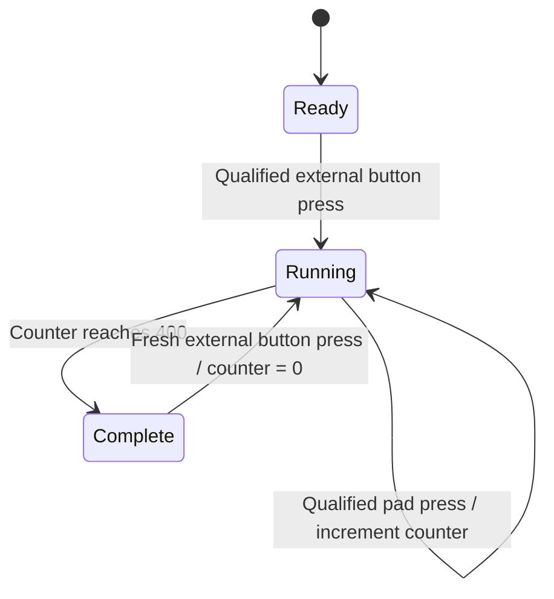

# Architecture and firmware behavior

## Device responsibilities

The **starter** owns session configuration and the start sequence. Its user interface progresses through pool, distance, delay, ready, countdown, swimming, and completion states. A DFPlayer Mini, controlled over UART, provides the audible cues.

The **touchpad** owns timing. On reception of a start packet it stores the pool and distance settings, resets the contact history, and records `millis()` as the local start time. Each accepted contact produces a cumulative elapsed time and an interval since the previous accepted contact. The final elapsed time is sent to the starter for display.

**TEST MODE** is a separate executable for the touchpad board. It does not initialize ESP-NOW or depend on the starter. Its state machine is independent of Arduino-specific display and GPIO code, allowing the actual counting logic to be evaluated in C++14 compile-time tests.

## Configuration and expected contacts

| Pool setting | Distance choices | Unit |
| --- | --- | --- |
| 25 yd | 25, 50, 100, 200 | yards |
| 25 m | 25, 50, 100, 200 | meters |
| 50 m | 50, 100, 200, 400 | meters |

The current normal touchpad computes the required number of contacts as:

```text
lengths = distance / pool_length
expected_contacts = max(1, floor(lengths / 2))
```

This represents one instrumented wall, generally contacted once per out-and-back trip. The one-length options still require one contact, so physical start and pad placement must suit the selected effort. A recorded interval is the time between contacts at this pad; it is not automatically a split for every pool length. The firmware has no opposite-wall sensor.

## Wireless protocol

The normal firmware uses [Espressif ESP-NOW](https://docs.espressif.com/projects/esp-idf/en/stable/esp32/api-reference/network/esp_now.html), a connectionless protocol between the ESP32 peers. Each device contains the other device's station MAC address. The current configuration uses the active Wi-Fi channel (`peerInfo.channel = 0`) and unencrypted peers (`peerInfo.encrypt = false`).

| Type | Direction | Contents | Effect |
| --- | --- | --- | --- |
| `1` | Starter → touchpad | `uint8_t type`, `uint8_t poolType`, `uint16_t distance` | Configure and begin an effort |
| `2` | Touchpad → starter | One-byte reset indication | Return the starter to setup after completion |
| `3` | Touchpad → starter | Packed `uint8_t type`, `uint32_t totalTimeMs` | Display the final elapsed time |
| `4` | Starter → touchpad | One-byte abort indication | Stop the effort and return the pad to waiting |

`FinishMessage` is explicitly packed and checked to be five bytes in both projects. `StartMessage` is transmitted as a native struct, so the current protocol assumes matching ESP32 firmware layouts. There is no protocol version, session identifier, application-level acknowledgement/retry scheme, or automatic pairing. Send status is logged to serial. The current receive paths should be hardened and their failure behavior measured before expanding beyond the paired prototype.

## Timing behavior

The starter sends the start packet and then commands audio track 2. The touchpad starts timing when its receive callback runs. Audio onset and the timer origin are therefore related events, not a calibrated shared timestamp.

Normal touch detection requires:

1. More than 3,000 ms since the received start event.
2. More than 2,000 ms since the previous accepted touch, except for the first touch.
3. An active-low input held continuously through a 150 ms validation interval.

The contact timestamp is taken after validation. Normal mode is level-sensitive with a cooldown; unlike TEST MODE, it does not require a qualified release before another contact can be counted. These differences matter when interpreting bench tests.

Time values are stored in milliseconds and formatted as `minutes:seconds.hundredths`. Before the first contact, the touchpad refreshes the visible timer at approximately 50 ms intervals. It then holds the recorded interval screen until another accepted contact. Hardware SPI runs the displays at 20 MHz, and changing values use partial redraws.

## TEST MODE state machine



- Pad qualification: 150 ms continuously pressed.
- Rearming: 30 ms continuously released after an accepted touch.
- Start/restart button qualification: 50 ms.
- Detection indicator: 120 ms; feedback does not introduce a cooldown.
- Counter: 16-bit, capped at 400.
- Button presses during a running test preserve the count.
- A pad held during start must be released before counting. A button held through completion cannot immediately restart the test.
- State is held in RAM; power cycling returns to the waiting screen.

## Scope

The repository contains firmware and its operating documentation. It does not contain mechanical drawings, waterproof enclosure specifications, a PCB design, a complete bill of materials, audio recordings, or measured timing/reliability datasets. Those can be added as the hardware and validation work develops.
